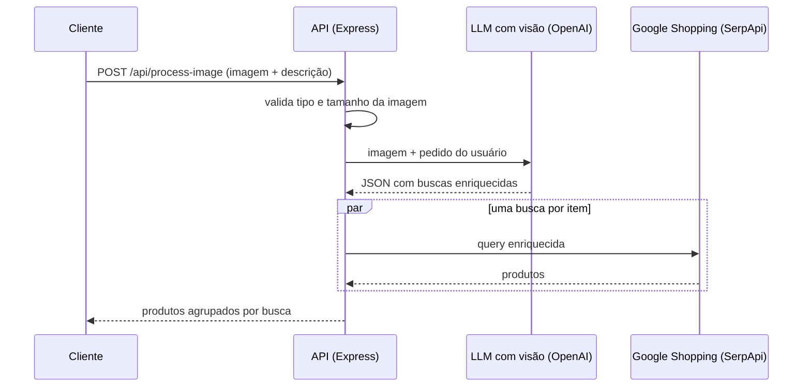

# Visual Product Search API

API em Node.js que encontra produtos à venda a partir da **foto de um ambiente**. O usuário envia a imagem e uma descrição curta (ex.: "sofá branco"); um LLM com visão analisa a foto, enriquece a busca com estilo, material e formato, e a API devolve produtos do Google Shopping.

Feito para quem trabalha com design de interiores e precisa achar rapidamente peças parecidas com as de uma referência.

## Como funciona



1. **Enriquecimento da busca.** O texto do usuário é só o ponto de partida. O modelo identifica o item pedido e acrescenta o que vê na imagem: "sofá branco" vira algo como "sofá branco de linho 3 lugares com pés de madeira clara estilo escandinavo". A resposta do modelo é forçada a JSON (`response_format: json_object`), o que deixa a etapa seguinte previsível.
2. **Busca dos produtos.** Cada query gerada é pesquisada em paralelo no Google Shopping (Brasil) via SerpApi. Uma busca que falha não derruba as outras.

## Stack

Node.js 18+, Express 5, Multer (upload em memória), SDK da OpenAI (`gpt-4o-mini` com visão) e SerpApi.

## Endpoints

### `POST /api/process-image`

`multipart/form-data`:

| Campo | Obrigatório | Descrição |
| --- | --- | --- |
| `image` | sim | Foto do ambiente (até 5 MB) |
| `description` | sim | O que procurar, ex.: `sofá branco` |
| `dimensions` | não | Detalhes extras, ex.: `linho, 2 metros` |

Resposta:

```json
{
  "sofá branco de linho 3 lugares com pés de madeira clara": [
    { "name": "Sofá 3 Lugares Linho Off White", "price": "R$ 2.499,00", "link": "https://...", "store": "Loja X" }
  ]
}
```

Erros de validação retornam `400` com `{ "error": "..." }`.

### `GET /api/health`

Retorna `{ "status": "ok" }`.

## Como rodar

```bash
npm install
cp .env.example .env   # preencha OPENAI_API_KEY e SERPAPI_API_KEY
npm run dev
```

Teste com curl:

```bash
curl -X POST http://localhost:3001/api/process-image \
  -F "image=@sala.jpg" \
  -F "description=sofá branco"
```

## Próximos passos

- Limite de requisições por IP para controlar custo das APIs
- Cache das buscas repetidas
- Testes automatizados com as APIs externas simuladas
